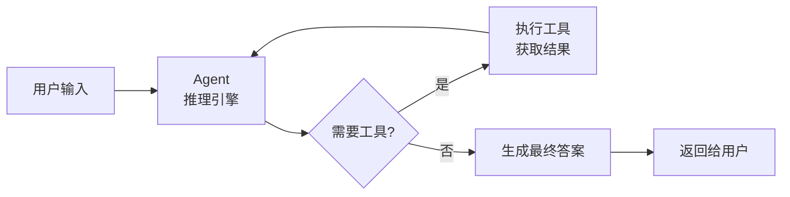

# java-pico Agent 框架详解与学习指南

## 前言 — 什么是 Agent 框架？



**Agent（智能体）** 是一个能自主推理、调用工具、解决问题的 AI 程序。它的核心循环是：

1. **理解**用户的问题
2. **决定**：是直接回答，还是需要调用工具获取更多信息
3. **执行工具**（搜索、读文件、计算等）
4. **整合结果**，继续推理，直到给出最终答案

java-pico 实现的是一个 **ReAct (Reasoning + Acting)** 风格的 Agent——模型在"思考-行动-观察"之间循环，直到解决问题。

---

## 第一章：框架架构总览

java-pico 的 Agent 框架由 **5 个核心组件** 构成：

```
┌─────────────────────────────────────────────────────┐
│                  用户界面层                          │
│  PicoCLI (终端 REPL)                                │
│  负责：用户输入/输出、彩色显示、编码修复             │
└──────────────┬──────────────────────────────────────┘
               │ userMessage / answer
               ▼
┌─────────────────────────────────────────────────────┐
│                  推理核心层                          │
│  PicoAgent                                          │
│  负责：Prompt构建 → LLM调用 → 响应解析 → 循环控制   │
│                                                     │
│  ┌──────────┐  ┌──────────┐  ┌──────────────────┐   │
│  │buildPrompt│→│complete  │→│    parse(响应)    │   │
│  └──────────┘  └──────────┘  └────────┬─────────┘   │
│                                        │             │
│                    ┌───────────────────┼─────┐       │
│                    ▼                   ▼     ▼       │
│               <tool> 标签         <final> 标签       │
│                    │                   │             │
│                    ▼                   │             │
│             executeTool()              │             │
│                    │                   │             │
│                    ▼                   ▼             │
│              继续循环 ← ← ← ← ←  返回最终答案       │
└──────────────┬──────────────────────────────────────┘
               │ 调用 LLM API
               ▼
┌─────────────────────────────────────────────────────┐
│                  LLM 通信层                          │
│  DeepSeekClient                                      │
│  负责：HTTP 调用 LLM 的 API                          │
└─────────────────────────────────────────────────────┘
```

### 组件职责速览

| 组件 | 职责 | 关键方法 |
|------|------|---------|
| **PicoCLI** | 终端界面层，读取用户输入，打印最终答案 | `run()` |
| **PicoAgent** | 推理核心，控制 Agent 循环 | `ask()`, `buildPrompt()`, `parse()`, `executeTool()` |
| **DeepSeekClient** | LLM 通信，调用 API 获取回复 | `complete()` |
| **CodeTool / WebSearchTool / RagRetriever** | 工具层，各司其职 | `listFiles()`, `search()`, `rerank()` 等 |

---

## 第二章：核心循环深度解析

### 2.1 ask() — Agent 的入口

```java
public String ask(String userMessage) {
    history.add(Map.of("role", "user", "content", userMessage));

    int toolSteps = 0;
    int attempts = 0;
    int maxAttempts = maxSteps + 3;

    while (toolSteps < maxSteps && attempts < maxAttempts) {
        attempts++;
        String prompt = buildPrompt(userMessage, history);
        
        String raw = llm.complete(prompt, maxNewTokens);
        ParseResult parsed = parse(raw);
        
        switch (parsed.kind) {
            case "tool"  -> { toolSteps++; executeTool(...); }
            case "final" -> { return parsed.content; }
            case "error" -> { return "Error: ..."; }
            case "retry" -> { /* 继续循环 */ }
        }
    }
    return "Stopped after step limit.";
}
```

**这是整个框架最核心的循环**。我们来逐行理解：

**第 1 行**：把用户消息加入 `history` 列表，构建完整的上下文。

**第 4-5 行**：两个计数器：
- `toolSteps`：实际调用工具的步数（限制是 `maxSteps`，默认 8）
- `attempts`：总尝试次数（包括重试，上限 = maxSteps + 3）

**第 7 行**：构建 Prompt。这是 Agent 的灵魂——告诉 LLM 它是什么、有什么工具、当前的上下文是什么。

**第 9 行**：调用 LLM。`raw` 是 LLM 返回的原始文本。

**第 10 行**：解析 LLM 的响应。看它返回了哪种标签。

**第 12-18 行**：根据标签类型分派：
- `<tool>`：执行工具，结果加入历史，继续循环
- `<final>`：答案提取出来，返回给用户
- `<error>`：出错，直接返回
- `retry`：格式不对，让 LLM 重试

**第 23 行**：超过步数限制，返回超时提示。

> 💡 **理解这个循环是理解 Agent 的关键**：它不是一次性生成答案，而是一个"推理→行动→观察→再推理"的迭代过程。

---

### 2.2 buildPrompt() — 如何给 LLM 下指令

Prompt 是 Agent 与 LLM 之间的"通信协议"。它的结构决定了 LLM 能否正确理解任务。

#### 完整 Prompt 模板（伪代码）：

```
You are java-pico, an AI assistant specialized in Java interview preparation.

RULES:
- For Java interview questions: FIRST call search_knowledge ONCE, then answer.
- For general questions: answer directly.
- For real-time info: use web_search.

Reply with EXACTLY one of:
<tool>{"name":"...","args":{...}}</tool>
<final>Your answer</final>

=== AVAILABLE TOOLS ===
- search_knowledge {"query":"..."}   搜索知识库
- web_search {"query":"..."}         搜索网络
- list_files {"path": "."}           列出目录
- read_file {"path":"...","start":1,"end":120}  读文件
- write_file / patch_file / search   文件编辑操作

Workspace: /path/to/workspace
Files:
[D] src
[F] pom.xml
...

History:
user: JVM垃圾回收机制有哪些算法？
assistant: <tool>{"name":"search_knowledge","args":{"query":"JVM垃圾回收算法"}}</tool>
Knowledge base results:
--- Result 1 (source: JVM.pdf) ---
JVM主要有以下垃圾回收算法：...

User: JVM垃圾回收机制有哪些算法？
```

#### Prompt 设计的四个要点

| 要点 | 说明 | 为什么重要 |
|------|------|-----------|
| **角色定义** | "You are java-pico, an AI assistant..." | 告诉 LLM 它的身份和任务范围 |
| **规则约束** | "For Java questions: FIRST call search_knowledge" | 规范 LLM 的行为模式 |
| **输出格式** | "Reply with EXACTLY one of: \<tool\> or \<final\>" | 让 LLM 的输出可解析——这是整个框架的基础 |
| **上下文注入** | 工作区快照 + 历史记录 | 让 LLM "看到"当前环境和之前的对话 |

> 💡 **关键洞察**：Agent 框架的"智能"实际上来自精心设计的 Prompt。框架本身只是提供了一个循环机制，真正做决策的是 LLM。

---

### 2.3 parse() — 如何理解 LLM 的回复

parse() 方法负责把 LLM 返回的**自然语言文本**解析成**结构化指令**。

```java
private static ParseResult parse(String raw) {
    // 1. 检查有没有 <error> 标签
    if (matches error tag) → return new ParseResult("error", ...)
    
    // 2. 检查有没有 <tool> 标签
    if (matches tool tag) {
        JSON = extract from <tool>...</tool>
        name = JSON.name      // → "search_knowledge"
        args = JSON.args      // → {"query": "..."}
        return new ParseResult("tool", name, args, ...)
    }
    
    // 3. 检查有没有 <final> 标签
    if (matches final tag) {
        answer = extract from <final>...</final>
        return new ParseResult("final", content: answer)
    }
    
    // 4. 兜底：大段无标签文本也当作 final
    if (text.length > 50 && no <tool> tag) {
        return new ParseResult("final", content: text)
    }
    
    // 5. 以上都不匹配 → 重试
    return new ParseResult("retry", ...)
}
```

#### ParseResult 的结构

```java
class ParseResult {
    String kind;       // "tool" | "final" | "error" | "retry"
    String name;       // 工具名（当 kind="tool" 时）
    Map<String, Object> args;  // 工具参数（当 kind="tool" 时）
    String content;    // 内容（答案、错误信息等）
}
```

#### 为什么需要 5 层检查？

| 优先级 | 检查项 | 场景 |
|--------|--------|------|
| 1 | `<error>` | LLM 或工具执行出错 |
| 2 | `<tool>` | LLM 要求调用工具（正常流程） |
| 3 | `<final>` | LLM 给出最终答案（正常流程） |
| 4 | 无标签但文本长 | 防止 `max_new_tokens` 截断导致 `</final>` 丢失 |
| 5 | 兜底 retry | 格式完全不匹配，让 LLM 重新生成 |

> 💡 **兜底逻辑是生产环境的关键**：LLM 的输出不一定总带完整标签。当 max_tokens 限制导致输出被截断时，`</final>` 可能被切掉。第 4 层检查就是处理这种情况的"安全网"。

---

### 2.4 executeTool() — 工具路由

```java
private String executeTool(String name, Map<String, Object> args) {
    return switch (name) {
        case "list_files"       -> codeTool.listFiles(asStr(args.get("path"), "."));
        case "read_file"        -> codeTool.readFile(...);
        case "write_file"       -> codeTool.writeFile(...);
        case "patch_file"       -> codeTool.patchFile(...);
        case "search"           -> codeTool.search(...);
        case "search_knowledge" -> ragRetriever.search(asStr(args.get("query"), ""));
        case "web_search"       -> webSearchTool.search(asStr(args.get("query"), ""));
        default                 -> "error: unknown tool '" + name + "'";
    };
}
```

这是一个典型的**策略模式**（或叫**路由表**）：
- 根据工具名（`name`）找到对应的工具方法
- 从 `args` Map 中提取参数（注意 JSON 反序列化后可能是 String 或 Integer，需要 `asStr()`/`asInt()` 转换）
- 执行工具，返回结果文本
- 结果会通过 `history.add()` 传回给 LLM 做下一步推理

---

## 第三章：框架设计模式深度剖析

### 3.1 第一性原理：Agent = Prompt 工程 + 循环

通常学习 Agent 框架容易陷入"看代码看不懂"的困境，其实 Agent 框架的根本原理可以用一句话概括：

```
Agent = 精心设计的 Prompt + 一个 while 循环
```

#### 把"智能"拆解开

| 传统认知 | 实际原理 |
|---------|---------|
| "Agent 会思考" | Agent 把问题塞进 Prompt，让 LLM 思考 |
| "Agent 会做决策" | Agent 解析 LLM 的文本输出，判断下一步 |
| "Agent 会使用工具" | Agent 告诉 LLM 有哪些工具可用，LLM 用文本格式选择 |
| "Agent 会记忆" | Agent 把历史对话拼接进 Prompt |

**示例**：当用户问"JVM 垃圾回收算法"时，实际上发生的事情是：

```
框架的视角：
1. 构建包含"规则、工具列表、历史"的 Prompt
2. 发送给 LLM
3. LLM 返回："<tool>{"name":"search_knowledge","args":{"query":"JVM 垃圾回收算法"}}</tool>"
4. 框架解析出工具名和参数
5. 调用 search_knowledge 工具
6. 把知识库结果拼入 Prompt
7. 再次发送给 LLM
8. LLM 返回："<final>JVM 主要有以下垃圾回收算法：...</final>"
9. 框架提取答案，返回给用户
```

**Agent 只是一个"文本到文本"的转换管道**。所有的"智能"都来自 LLM，框架只是：
1. 把上下文组织好（Prompt）
2. 把 LLM 回复的标签解析出来（parse）
3. 调用实际功能（工具）
4. 重复以上步骤直到结束

### 3.2 为什么用文本标签而不是 JSON？

你可能会问：为什么不直接用结构化的 JSON 格式来通信？比如 LLM 返回 `{action: "tool", name: "search_knowledge"}`？

#### 用标签的原因

| 方案 | 优点 | 缺点 |
|------|------|------|
| **文本标签 `<tool>`** | 容错性强，LLM 自然输出，人类可读 | 解析略微复杂 |
| **纯 JSON** | 解析简单 | LLM 不一定能稳定输出纯 JSON；混合文本+JSON 更难解析 |
| **工具调用 (Function Calling)** | 原生支持结构化输出 | 依赖 LLM 厂商的实现，不可移植 |

java-pico 选择了 **纯文本标签** 方案，因为：
1. LLM 天生擅长生成文本，文本标签是最自然的通信方式
2. 不依赖 LLM 厂商的特定功能，**任何文本模型**都可以用
3. 调试直观——开发者可以直接看到 LLM 输出了什么
4. 容错性好——即使输出不完整也能兜底

### 3.3 历史管理策略

历史记录是 Agent 的"记忆"。java-pico 用 `List<Map<String, String>>` 来存储，每条记录有：

```
{role: "user",     content: "问题"}           ← 用户消息
{role: "assistant",content: "<tool>..."}      ← LLM 的回复
{role: "tool",     name: "search_knowledge",   ← 工具执行结果
                   content: "结果文本..."}
```

#### 历史压缩策略

因为 LLM 有上下文窗口限制（通常是 4K-128K tokens），不能无限塞历史。java-pico 采用：

1. **只保留最近 12 轮**：`history.subList(history.size() - 12, history.size())`
2. **工具结果截断**：工具内容超过 300 字符就截断
3. **用户/助手消息截断**：超过 200 字符就截断
4. **特殊格式化**：工具结果按类型（knowledge / web_search / 其他）加上不同的前缀

```java
private static String renderHistory(List<Map<String, String>> history) {
    List<Map<String, String>> recent = history.size() > 12
        ? history.subList(history.size() - 12, history.size())
        : history;
    // 按 role 格式化...
}
```

### 3.4 错误处理与降级策略

Agent 框架必须处理各种异常情况。java-pico 实现了多层降级：

| 层次 | 异常 | 处理方式 |
|------|------|---------|
| **LLM 调用失败** | HTTP 错误、网络超时 | 返回 `<error>LLM API error: HTTP 500 - ...</error>` |
| **工具调用失败** | 文件不存在、路径溢出 | 返回 `"error: tool xxx failed: ..."` |
| **Rerank 失败** | API 不可用 | 降级为纯向量检索结果 |
| **解析失败** | LLM 输出格式错误 | 标记为 `retry`，让 LLM 重新生成 |
| **截断兜底** | `</final>` 被切掉 | 大段无标签文本也当作 final 答案 |

#### 降级不仅是稳定性，也是安全性

```java
// 路径安全：防止 Agent 访问工作区外的文件
private Path resolve(String path) {
    Path candidate = workspaceRoot.resolve(path).normalize();
    if (!candidate.startsWith(workspaceRoot)) {
        throw new IllegalArgumentException("Path escapes workspace: " + path);
    }
    return candidate;
}
```

### 3.5 从 Prompt 中"编程"Agent

java-pico 最巧妙的设计之一是用 Prompt 来定义 Agent 的行为规则，而不是用代码。这意味着**修改行为通常只需要改 Prompt，不需要改代码**。

#### 示例：知识库优先策略

```java
// 在 Prompt 中包含的规则
RULES:
- For Java interview questions: FIRST call search_knowledge ONCE, then answer based on results.
- For general questions (about tools, chat, etc.): answer directly, no search needed.
- For real-time info (news, jobs): use web_search.
```

这 3 条规则定义了 Agent 的全部行为策略：
- **面试题** → 查知识库 → 回答
- **闲聊** → 直接回答
- **实时信息** → 网页搜索

如果你想修改规则，比如"所有问题都必须先查知识库"，只需要改 Prompt 文本，不需要改代码循环。

---

## 第四章：一步一步实现你自己的 Agent

看完 java-pico 的代码后，你可以自己实现一个简化版 Agent。下面是最小实现：

### Step 1: 基本循环

```java
public class MyAgent {
    private final LlmClient llm;        // 你的 LLM 客户端
    private final List<String> history = new ArrayList<>();
    
    public String ask(String userMessage) {
        history.add("User: " + userMessage);
        
        for (int step = 0; step < 10; step++) {
            String prompt = buildPrompt(userMessage);
            String response = llm.complete(prompt);
            
            if (response.contains("<final>")) {
                String answer = extract(response, "<final>", "</final>");
                history.add("Assistant: " + answer);
                return answer;
            }
            
            if (response.contains("<tool>")) {
                String toolJson = extract(response, "<tool>", "</tool>");
                String toolResult = executeTool(parseToolName(toolJson), parseToolArgs(toolJson));
                history.add("Tool result: " + toolResult);
                continue;  // 继续循环
            }
            
            // 格式不对，重试
        }
        return "Failed to get answer.";
    }
}
```

### Step 2: 最小可运行版本

以下是 50 行就能跑的最小 Agent 框架：

```java
import java.net.URI;
import java.net.http.*;
import java.util.regex.Pattern;

public class MinimalAgent {
    static final HttpClient http = HttpClient.newHttpClient();
    static final Pattern TOOL = Pattern.compile("<tool>(.*?)</tool>", Pattern.DOTALL);
    static final Pattern FINAL = Pattern.compile("<final>(.*?)</final>", Pattern.DOTALL);
    
    String apiKey, model;
    
    public MinimalAgent(String apiKey, String model) {
        this.apiKey = apiKey;
        this.model = model;
    }
    
    public String ask(String question) throws Exception {
        StringBuilder history = new StringBuilder();
        int step = 0;
        
        while (step++ < 8) {
            String prompt = """
                You are a helpful assistant. You can use tools.
                
                Available tools:
                - get_time — get current time
                
                Reply with:
                <tool>{"name":"get_time"}</tool>
                or
                <final>Your answer</final>
                
                History:
                """ + history.toString() + "\n\nQuestion: " + question;
            
            String response = callLLM(prompt);
            
            var m = FINAL.matcher(response);
            if (m.find()) return m.group(1).trim();
            
            m = TOOL.matcher(response);
            if (m.find()) {
                history.append("Tool(get_time): " + getCurrentTime() + "\n");
                continue;
            }
        }
        return "Failed.";
    }
    
    String callLLM(String prompt) throws Exception {
        String json = """
            {"model":"%s","messages":[{"role":"user","content":"%s"}]}
            """.formatted(model, prompt.replace("\"", "\\\""));
        
        HttpRequest req = HttpRequest.newBuilder()
            .uri(URI.create("https://api.deepseek.com/v1/chat/completions"))
            .header("Authorization", "Bearer " + apiKey)
            .header("Content-Type", "application/json")
            .POST(HttpRequest.BodyPublishers.ofString(json))
            .build();
        
        // 解析响应...
        return "...";
    }
    
    String getCurrentTime() {
        return java.time.LocalDateTime.now().toString();
    }
}
```

这个最小实现只有 **5 个核心概念**：

| 概念 | 代码量 | 作用 |
|------|--------|------|
| LLM 客户端 | 15 行 | 调用 API |
| Prompt 构建 | 10 行 | 告诉 LLM 上下文和规则 |
| 响应解析 | 5 行 | 解析 `<tool>` / `<final>` |
| 工具路由 | 5 行 | 根据名称分发到具体方法 |
| 循环控制 | 10 行 | 迭代直到拿到最终答案 |

---

## 第五章：手把手构建自己的 Agent 框架

### 5.1 设计流程

如果你想从零开始构建，按这个顺序：

```
1. 明确 LLM 能做什么
   → 选择一个 LLM API（DeepSeek、OpenAI、通义千问...）
   → 实现最基础的文本聊天调用
   
2. 定义通信协议
   → 确定 LLM 用什么格式来选择工具
   → 建议：<tool>JSON</tool> 和 <final>答案</final>
   
3. 实现解析器
   → 写正则或字符串提取
   → 一定要有兜底逻辑（LLM 的输出不总是完美的）
   
4. 实现工具
   → 实现具体功能（文件操作、搜索、计算等）
   → 确保错误不会导致整个 Agent 崩溃
   
5. 组装循环
   → Prompt → LLM → 解析 → 如果 tool 则执行 → 继续循环
   → 设置步数上限
   
6. 迭代优化
   → 观察 LLM 的行为，调整 Prompt
   → 添加历史管理
   → 添加错误处理
```

### 5.2 常见陷阱与解决方案

| 陷阱 | 现象 | 解决方案 |
|------|------|---------|
| **LLM 不按格式输出** | parse() 总是返回 retry | Prompt 中加更多示例（few-shot）；降低 `max_new_tokens` 避免截断 |
| **工具循环不停止** | LLM 反复调用同一个工具 | 设置 `maxSteps` 上限；修正工具 Prompt 描述 |
| **上下文爆炸** | Prompt 越来越长直到超限 | 截断历史；压缩工具结果；总结历史 |
| **路径穿越** | LLM 尝试读取系统文件 | 严格校验路径不能逃逸工作区 |
| **编码问题** | 中文乱码 | Scanner 用 UTF-8；System.out 重包装为 UTF-8 PrintStream |

---

## 第六章：进阶之路

### 6.1 从标签到 Function Calling

java-pico 使用文本标签，但是工业级 Agent 框架（如 LangChain、AutoGen）通常使用 LLM 的 **Function Calling（工具调用）** 能力：

```json
// Function Calling 方式（OpenAI API）
{
  "choices": [{
    "message": {
      "content": null,
      "tool_calls": [{
        "function": {
          "name": "search_knowledge",
          "arguments": "{\"query\":\"JVM垃圾回收\"}"
        }
      }]
    }
  }]
}
```

**文本标签 vs Function Calling**：

| 对比维度 | 文本标签 (java-pico) | Function Calling |
|---------|-------------------|------------------|
| 实现复杂度 | 低，纯字符串处理 | 中，需要处理结构化 API |
| 模型依赖 | 任何文本模型 | 需 API 支持 |
| 解析稳定度 | 中（需容错处理） | 高（结构化输出） |
| 灵活度 | 高（可混写文本/标签） | 低（严格 schema） |
| 调试友好度 | 高（直接看文本） | 中（看 JSON） |

### 6.2 从同步到流式

当前实现是同步的——等待 LLM 完整回复后才处理。进阶可以做**流式（SSE/Streaming）**：

```java
// 流式接收 LLM 的输出
void completeStream(String prompt, Consumer<String> onChunk) {
    HttpRequest req = HttpRequest.newBuilder()
        .uri(URI.create(baseUrl + "/v1/chat/completions"))
        .header("Content-Type", "application/json")
        .POST(HttpRequest.BodyPublishers.ofString(
            json.with("stream", true).toString()
        ))
        .build();
    
    http.send(req, HttpResponse.BodyHandlers.ofLines());
    // 逐行解析 SSE: "data: {"choices":[{"delta":{"content":"..."}}]}"
    // 在每个 chunk 到达时调用 onChunk()
}
```

**流式的好处**：
- 用户能立即看到 LLM 开始输出，延迟感知降低
- 可以逐 chunk 解析工具调用，提前开始执行工具
- 显式的 token 到达节奏，可以做实时 token 计数

### 6.3 从单 Agent 到多 Agent

更复杂的场景可能需要多个 Agent 协作：

```
┌─────────────┐
│  Supervisor │← 负责分配任务、协调结果
│  (主管)     │
└──────┬──────┘
       │
   ┌───┼───┬───┐
   ▼   ▼   ▼   ▼
┌────┐┌────┐┌────┐┌────┐
│ 编程 ││ 搜索 ││ 分析 ││ 写作 │
│Agent││Agent││Agent││Agent│
└────┘└────┘└────┘└────┘
```

多 Agent 架构需要的核心机制：
1. **Agent 通信**：Agent 之间如何交换消息
2. **任务分解**：主管如何把一个大问题拆成子任务
3. **结果聚合**：如何把多个 Agent 的结果合并成统一答案
4. **冲突解决**：Agent 给出矛盾结论时怎么办

---

## 第七章：总结

### 构建 Agent 的黄金法则

1. **Agent = Prompt + 循环** —— 不要把事情想复杂了
2. **LLM 的输出格式决定一切** —— 解析器是连接 LLM 和工具的桥梁，必须健壮
3. **兜底比完美更重要** —— LLM 的输出永远会有意外，容错处理决定系统的稳定性
4. **历史管理是记忆** —— 控制上下文窗口大小，压缩但不丢失关键信息
5. **错误隔离** —— 工具执行失败不应该让整个 Agent 崩溃

### java-pico 框架的可借鉴之处

| 设计点 | 值得学习的地方 |
|--------|---------------|
| 标签协议 | 简单有效，适合学习和原型开发 |
| 三层配置 | 环境变量 > 文件 > 默认值，生产环境必备 |
| 两阶段检索 | 向量 + Rerank，精度和速度的平衡 |
| 编码修复 | 处理中文环境的具体问题，展现工程思维 |
| 彩色输出 | 提升终端用户体验的小细节 |

### 推荐的学习路径

```
1. 理解核心概念 (本文)
   → Agent 的原理和设计模式
   
2. 通读代码 
   → PicoAgent.java (核心循环)
   → DeepSeekClient.java (LLM通信)
   → PicoConfig.java (配置加载)
   
3. 动手修改
   → 添加一个自己的工具 (计算器、天气查询等)
   → 修改 Prompt 规则
   → 改变历史压缩策略
   
4. 从零实现
   → 自己写一个最小 Agent (参考第四章的 MinimalAgent)
   → 逐步添加功能
   
5. 进阶探索
   → 切换到 Function Calling
   → 实现流式输出
   → 尝试多 Agent 架构
```
