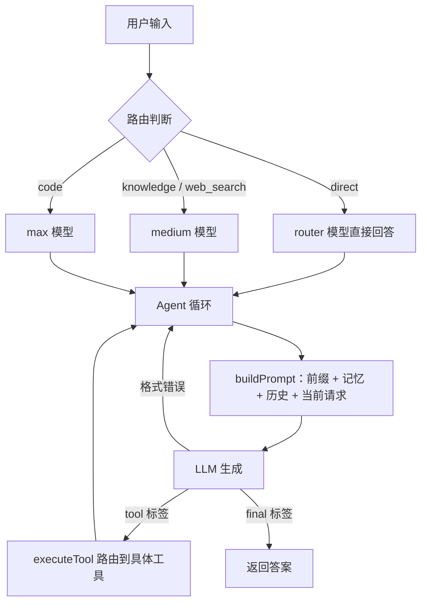

# java-pico

一个跑在终端里的 Java 面试助手：自己实现的 ReAct Agent 循环 + RAG 知识库 + 文件/搜索工具。

不依赖 LangChain4j 的 `AiServices`，Prompt 拼装、`<tool>` / `<final>` 标签解析、工具路由、历史压缩全部手写，
整个 Agent 循环收敛在 `PicoAgent` 一个类里，方便看清"Agent 到底是什么"。

- Java 21 · Spring Boot 4.0.6 · LangChain4j 1.1.0
- 通过 OpenAI 兼容接口调用模型，默认走 DashScope（`qwen3-8b` / `qwen3.7-plus` / `qwen3.7-max` 三级路由）
- 知识库用 PostgreSQL + pgvector，两阶段检索（向量召回 + Rerank 精排）

## 特性

| 特性 | 说明 |
|------|------|
| 自研 Agent 循环 | 文本标签协议（`<tool>` / `<final>`），不用 Function Calling，输出不稳定时自动重试 |
| 三级模型路由 | 先判断问题类型（`direct` / `knowledge` / `web_search` / `code`），再挑对应档位的模型，省掉不必要的贵模型调用 |
| 结构化记忆 | 任务摘要、最近文件、文件摘要、情节笔记四层，全部由代码规则提炼，不额外消耗 token |
| 会话持久化 | Session / Run 两级存储，每次工具调用可回溯（`trace.jsonl`） |
| Prompt 预算 | 总字符预算 12000，超了按「相关记忆 → 历史 → 文件摘要 → 系统前缀」逐级压缩 |
| RAG 知识库 | PDF → 向量化 → pgvector；向量召回 20 条 → Rerank 精排 5 条 |
| 终端 UX | REPL 交互、彩色输出、`/exit` `/history` 指令 |

## 快速开始

### 1. 环境要求

- JDK 21+
- Maven（仓库自带 `mvnw`，无需单独安装）
- PostgreSQL + [pgvector](https://github.com/pgvector/pgvector)（使用知识库检索时需要）

### 2. 配置

配置有两处，都**不在版本库内**（已被 `.gitignore` 忽略）：

**`.pico/config.json`** —— Agent 自身的参数：

```json
{
  "api_key": "sk-xxx",
  "base_url": "https://dashscope.aliyuncs.com/compatible-mode",
  "router_model": "qwen3-8b",
  "medium_model": "qwen3.7-plus",
  "max_model": "qwen3.7-max",
  "workspace": ".",
  "max_steps": 8,
  "max_new_tokens": 2048
}
```

也可以用环境变量覆盖，优先级高于文件：`API_KEY` / `DEEPSEEK_API_KEY`、`BASE_URL`、`ROUTER_MODEL`、
`MEDIUM_MODEL`、`MAX_MODEL`、`RAG_URL`。

**`src/main/resources/application-local.yml`** —— 数据库、Embedding、Rerank 的密钥：

```yaml
spring:
  datasource:
    url: jdbc:postgresql://localhost:5432/ai_helper_db
    username: postgres
    password: your-password

langchain4j:
  community:
    dashscope:
      chat-model:
        model-name: qwen-turbo
        api-key: sk-xxx
      embedding-model:
        model-name: text-embedding-v4
        api-key: sk-xxx
  store:
    embedding:
      pgvector:
        table-name: document_embeddings
        dimension: 1024
        distance-type: COSINE

search:
  api-key: your-search-key

rerank:
  enabled: true
  api-key: sk-xxx
  model-name: qwen3-rerank
  candidate-count: 20
  max-results: 5
  min-score: 0.5
  embedding-min-score: 0.70
```

知识库 PDF 放在 `src/main/resources/docs/pdf/pdf/`，首次启动时由 `RagConfig` 解析入库。这个目录同样被忽略，
需要自己放入文档。

### 3. 启动

```bash
./mvnw spring-boot:run -Dspring-boot.run.profiles=cli
```

或先打包：

```bash
./mvnw clean package
java -jar target/ai-helper-0.0.1-SNAPSHOT.jar --spring.profiles.active=cli
```

`cli` profile 会关闭 Web 服务器。无参数直接跑（不带 profile）则是普通 Spring Boot Web 应用。

## 使用

进入 REPL 后直接输入问题即可，Agent 会自己决定是回答、查知识库、搜网页，还是读写工作区文件。

| 指令 | 作用 |
|------|------|
| 普通文本 | 交给 Agent 主循环处理 |
| `/history` | 打印当前会话的历史消息 |
| `/exit`、`/quit` | 退出 |

## 工具清单

| 工具 | 归属 | 说明 |
|------|------|------|
| `list_files` | `CodeTool` | 列出目录 |
| `read_file` | `CodeTool` | 按行号区间读文件 |
| `write_file` | `CodeTool` | 写文件 |
| `patch_file` | `CodeTool` | 精确替换文件片段 |
| `search` | `CodeTool` | 在工作区内搜索代码 |
| `run_shell` | `PicoAgent` | 执行 shell 命令，**必须终端里输入 `y` 审批**；不继承父进程环境变量，超时上限 120 秒 |
| `search_knowledge` | `RagRetriever` | 检索本地知识库 |
| `web_search` | `WebSearchTool` | 网页搜索 |
| `current_time` | `CurrentTimeTool` | 当前时间 |

## 架构



### 三级模型路由

先用最便宜的模型给问题分类，再决定后续用哪档模型：`direct` 用 router，`knowledge` / `web_search` 用
medium，`code` 用 max。路由标签识别不出来时默认按 `knowledge` 走完整 Agent 循环，不会卡死。

### 记忆与持久化

- `SessionMemory` 维护四类记忆：任务摘要、最近文件、文件摘要（带新鲜度校验）、情节笔记。
- `SessionStore` 落 `.pico/session.json`，`RunStore` 落 `.pico/runs/<run_id>/`，
  内含 `trace.jsonl`（逐轮工具调用）和 `report.json`。

### Prompt 预算

`PicoAgent.buildPrompt` 有多级降级：整体超过 12000 字符时，依次裁掉相关记忆、收紧历史预算
（从 5200 字符往下压）、截断文件摘要、最后丢掉文件摘要并进一步压历史。当前用户请求永远保留。

## 基准测试

`benchmarks/` 下是一套文件操作任务的评测，7 个任务覆盖改配置、读代码、加方法、搜索、改 README 等场景。

```bash
python3 benchmarks/run.py            # 列出所有任务
python3 benchmarks/run.py --all      # 跑全部
python3 benchmarks/run.py search_in_code   # 跑单个
```

## 测试

```bash
./mvnw test
```

覆盖 `CodeTool`、`PicoAgent`、`SessionMemory`，共 16 个用例。

## 目录结构

```
src/main/java/org/ai/aihelper/
├── pico/
│   ├── PicoCLI.java          # 终端 REPL 入口（cli profile）
│   ├── PicoAgent.java        # Agent 循环：路由 / 拼 Prompt / 解析 / 工具执行 / 压缩
│   ├── DeepSeekClient.java   # OpenAI 兼容 HTTP 客户端
│   ├── PicoConfig.java       # 环境变量 + .pico/config.json 配置
│   ├── SessionMemory.java    # 结构化记忆
│   ├── SessionStore.java     # 会话持久化
│   ├── RunStore.java         # 单次运行持久化
│   └── RagRetriever.java     # 知识库检索包装
└── ai/
    ├── tools/                # CodeTool / WebSearchTool / CurrentTimeTool
    └── rag/                  # RAG 初始化、Rerank 客户端、两阶段检索器
```

## 文档

- [项目说明文档.md](项目说明文档.md) —— 模块拆解、数据流、关键设计决策
- [Agent框架详解与学习指南.md](Agent框架详解与学习指南.md) —— 从零讲清 Agent 循环怎么实现
- [ai-helper_SUMMARY_FOR_INTERVIEW.md](ai-helper_SUMMARY_FOR_INTERVIEW.md) —— 面试角度的项目总结
