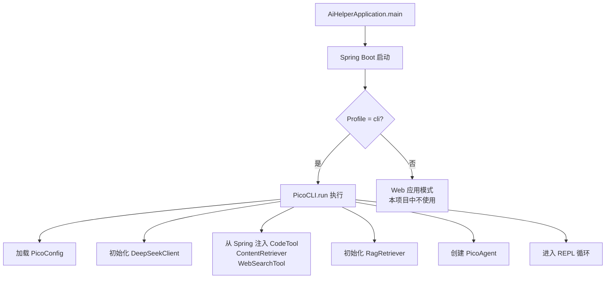
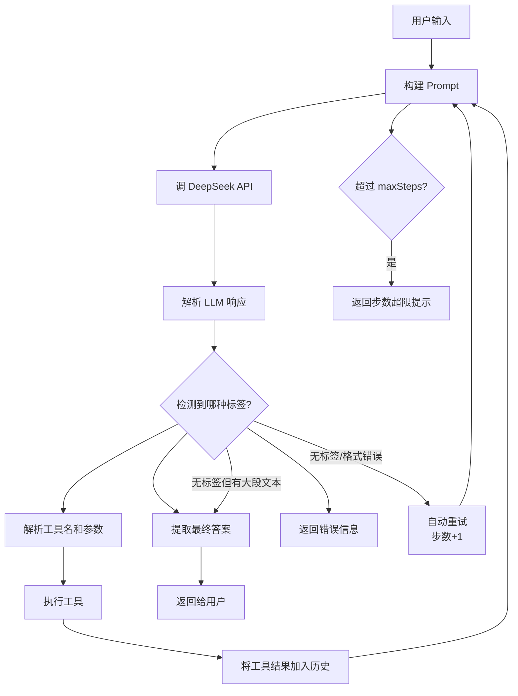
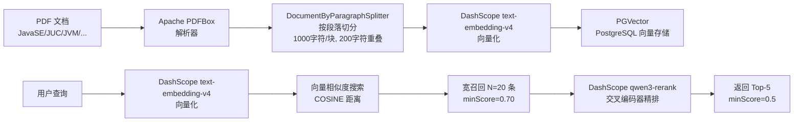
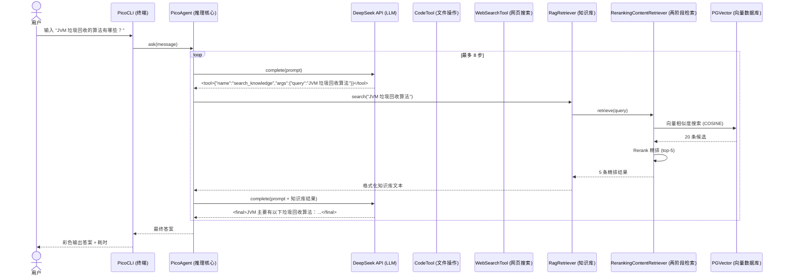

# java-pico — AI Agent 项目说明文档

## 一、项目概述

**java-pico** 是一个基于 Spring Boot + LangChain4j 构建的 **AI 命令行助手**，专注于 **Java 面试辅导**。它运行在终端（REPL 模式），通过调用 DeepSeek 大语言模型（LLM），配合 **RAG 知识库检索**、**文件操作** 和 **网页搜索** 等工具，帮助用户解答 Java 面试问题并处理工作区文件。

### 核心特性

| 特性 | 说明 |
|------|------|
| **终端交互** | 命令行 REPL 界面，支持彩色输出、中文输入 |
| **LLM 驱动** | 调 DeepSeek API（OpenAI 兼容接口），自行拼 Prompt 实现 Agent 循环 |
| **RAG 知识库** | PDF 文档 → 向量化 → PostgreSQL/PGVector 存储 → 语义检索 |
| **两阶段检索** | 向量召回（宽召回）+ Rerank 精排（交叉编码器），兼顾召回率与精确率 |
| **工具系统** | 文件读写、代码搜索、网页搜索，由 LLM 自主调用 |
| **纯自研 Agent** | 不依赖 LangChain4j 的 AiServices，自实现 `<tool>` / `<final>` 标签解析循环 |

---

## 二、项目结构

```
java-pico/
├── pom.xml                                          # Maven 依赖管理
├── src/
│   ├── main/
│   │   ├── java/org/ai/aihelper/
│   │   │   ├── AiHelperApplication.java             # Spring Boot 入口
│   │   │   ├── pico/
│   │   │   │   ├── PicoConfig.java                  # 配置加载（文件 + 环境变量）
│   │   │   │   ├── DeepSeekClient.java              # LLM HTTP 客户端
│   │   │   │   ├── PicoCLI.java                     # 终端 REPL 入口
│   │   │   │   ├── PicoAgent.java                   # Agent 推理循环（核心）
│   │   │   │   └── RagRetriever.java                # RAG 检索包装器
│   │   │   └── ai/
│   │   │       ├── tools/
│   │   │       │   ├── CodeTool.java                # 文件/代码操作工具
│   │   │       │   ├── WebSearchTool.java           # 网页搜索工具
│   │   │       │   └── CurrentTimeTool.java         # 当前时间工具
│   │   │       └── rag/
│   │   │           ├── RagConfig.java               # RAG 初始化配置
│   │   │           ├── DashScopeRerankModel.java    # Rerank 模型客户端
│   │   │           └── RerankingContentRetriever.java # 两阶段检索器
│   │   └── resources/
│   │       ├── application.yml                      # 全局配置
│   │       ├── application-cli.yml                  # CLI 模式配置
│   │       ├── application-local.yml                # 本地环境配置（DB/API Key）
│   │       └── docs/pdf/pdf/                        # 知识库 PDF 文档
│   │           ├── JavaSE.pdf
│   │           ├── JUC.pdf
│   │           ├── JVM.pdf
│   │           ├── MQ.pdf
│   │           ├── MySQL.pdf
│   │           ├── Redis.pdf
│   │           ├── Spring全家桶.pdf
│   │           └── 计算机基础.pdf
│   └── target/                                      # 编译输出
```

---

## 三、代码运作原理详解

### 3.1 启动流程



**启动入口**：`AiHelperApplication.java` 是一个标准的 Spring Boot 入口类。加上 `@SpringBootApplication` 注解后，自动扫描 `org.ai.aihelper` 包下的所有 Bean。

**CLI 模式**：`PicoCLI.java` 标注了 `@Profile("cli")`，所以只有在指定 `--spring.profiles.active=cli` 时才会启动。启动后：

1. 加载 `PicoConfig`（从 `.pico/config.json` 文件 + 环境变量读取配置）
2. 创建 `DeepSeekClient`（LLM API 客户端）
3. 从 Spring 容器注入 `CodeTool`、`ContentRetriever`（RAG）、`WebSearchTool`
4. 创建 `RagRetriever`（包装 ContentRetriever）
5. 创建 `PicoAgent`（核心 Agent）
6. 进入 REPL 循环，等待用户输入

---

### 3.2 配置加载（PicoConfig）

`PicoConfig.java` 实现了 **三层优先级** 配置加载：

```
环境变量 > .pico/config.json 配置文件 > 默认值
```

| 配置项 | 环境变量 | 配置文件键 | 默认值 |
|--------|---------|-----------|--------|
| API Key | `DEEPSEEK_API_KEY` | `deepseek_api_key` | 空 |
| API 地址 | `DEEPSEEK_BASE_URL` | `deepseek_base_url` | `https://api.deepseek.com` |
| 模型名 | `DEEPSEEK_MODEL` | `deepseek_model` | `deepseek-v4-flash` |
| 工作区路径 | — | `workspace` | `.` |
| RAG 服务地址 | `RAG_URL` | `rag_url` | `http://localhost:8080` |
| 最大步骤数 | — | `max_steps` | `8` |
| 最大生成 Token | — | `max_new_tokens` | `2048` |

**技术细节**：`loadFileConfig()` 使用 Jackson 的 `ObjectMapper` 解析 `.pico/config.json`，支持 JSON 中值的灵活类型（`String` 或 `Integer`），`first()` 方法链式回退，`intVal()` 方法同时处理数字类型和字符串格式。

---

### 3.3 LLM 客户端（DeepSeekClient）

`DeepSeekClient.java` 是一个 **不依赖任何 SDK** 的 HTTP 客户端，直接通过 `java.net.http.HttpClient` 调用 DeepSeek 的 OpenAI 兼容 API。

```
POST /v1/chat/completions
Authorization: Bearer {apiKey}
Content-Type: application/json; charset=utf-8

{
  "model": "deepseek-v4-flash",
  "max_tokens": 2048,
  "temperature": 0.7,
  "messages": [
    {"role": "user", "content": "<完整 Prompt>"}
  ]
}
```

**关键设计**：
- 使用 `HttpRequest.BodyPublishers.ofByteArray(jsonBytes)` 确保 UTF-8 编码正确
- 使用 `HttpResponse.BodyHandlers.ofByteArray()` 接收响应，然后手动转 UTF-8 字符串
- 响应解析：从 `choices[0].message.content` 提取文本
- 异常处理：API 错误或网络异常返回 `<error>...</error>` 格式的字符串，让上层 Agent 能统一处理

---

### 3.4 Agent 推理循环（PicoAgent — 核心）

`PicoAgent.java` 是**整个系统的大脑**，实现了一个 **完全自研的 Agent 循环**，不依赖 LangChain4j 的 AiServices。

#### 3.4.1 工作流程



#### 3.4.2 Prompt 构建

`buildPrompt()` 方法动态构造发给 LLM 的完整提示词，包含以下部分：

```
You are java-pico, an AI assistant specialized in Java interview preparation.

RULES:
- For Java interview questions: FIRST call search_knowledge ONCE, then answer.
- For general questions: answer directly.
- For real-time info: use web_search.

Reply with EXACTLY one of:
<tool>{"name":"...","args":{...}}</tool>
<final>Your answer</final>

=== TOOLS ===
- search_knowledge {"query":"..."}
- web_search {"query":"..."}
- list_files / read_file / write_file / patch_file / search

Workspace: {workdir}
Files:
{D 目录名 / F 文件名 ...}

History:
{最近 12 轮交互历史}

User: {用户当前输入}
```

**设计要点**：
- **System Prompt 风格**：直接在每条消息前附上完整指令，因为 DeepSeek 接口只传递单条 user 消息
- **工作区快照**：每次请求都附带当前目录的文件列表，让 LLM 了解工作区结构
- **历史压缩**：仅保留最近 12 轮历史，每轮工具的 token 数控制在 300 以内，防止上下文过长
- **知识库优先**：明确告诉 LLM，Java 面试题必须先调 `search_knowledge`

#### 3.4.3 响应解析

`parse()` 方法按优先级解析 LLM 的输出文本：

| 检测顺序 | 匹配模式 | 结果类型 | 说明 |
|---------|---------|---------|------|
| 1 | `<error>(.*?)</error>` | `error` | API / 工具执行出错 |
| 2 | `<tool>(.*?)</tool>` | `tool` | LLM 要求执行工具，JSON 格式 |
| 3 | `<final>(.*?)</final>` | `final` | LLM 给出最终答案 |
| 4 | 无标签但文本 > 50 字符 | `final` | 兜底：当作最终答案（防止 max_new_tokens 截断导致 </final> 丢失） |
| 5 | 以上都不匹配 | `retry` | 格式错误，让 LLM 重试 |

工具 JSON 格式示例：
```json
{"name": "search_knowledge", "args": {"query": "JVM 垃圾回收机制"}}
```

#### 3.4.4 循环控制

- **maxSteps**：限制工具调用次数（默认 8），防止无限循环
- **maxAttempts**：= maxSteps + 3，给 LLM 一些重试空间
- 每步将结果写入 `history`（`List<Map<String, String>>`），下一步构建 Prompt 时携带
- 达到上限时返回 "Stopped after reaching the step limit"

#### 3.4.5 历史记录

`history` 字段记录了完整的交互历史，每条记录包含 `role`（user/assistant/tool）、`name`（工具名）、`args`（参数）、`content`（内容）。提供 `getHistory()` 方法供 PicoCLI 的 `/history` 命令读取。

---

### 3.5 工具系统

Agent 在每轮迭代中解析 LLM 的 `<tool>` 标签，通过 `executeTool()` 方法路由到对应的工具实现。

#### 3.5.1 文件操作工具（CodeTool）

`CodeTool.java` 是注册在 Spring 容器中的 `@Component`，使用 `@Tool` 注解定义工具接口（LangkChain4j 注解风格，但实际由 Agent 手动调用）。

| 工具名 | 功能 | 参数 |
|--------|------|------|
| `list_files` | 列出目录内容 | `path`（相对路径） |
| `read_file` | 读取文件指定行范围 | `path`, `start`, `end` |
| `write_file` | 写入/覆盖文件 | `path`, `content` |
| `patch_file` | 精确替换文件中的文本 | `path`, `old_text`, `new_text` |
| `search` | 在工作区搜索文本 | `pattern`, `path` |

**安全机制**：
- `resolve()` 方法验证路径不会逃逸出工作区（`path.startsWith(workspaceRoot)`），防止路径穿越攻击
- `IGNORED_NAMES` 跳过 `.git`、`node_modules`、`target` 等目录
- `search` 最多返回 80 条结果，使用 `Files.walkFileTree` 递归遍历

#### 3.5.2 网页搜索工具（WebSearchTool）

`WebSearchTool.java` 调用 **Tavily Search API**（一个 AI 优化的搜索引擎 API）。

- POST 请求到 `https://api.tavily.com/search`
- 每次返回 5 条结果（标题 + 摘要 + URL）
- 用于回答需要实时信息的问题（新闻、招聘、最新资讯）

#### 3.5.3 当前时间工具（CurrentTimeTool）

简单的工具，返回格式化的当前日期时间（中文格式），未在当前的 Agent Prompt 中启用，但注册在 Spring 容器中可供扩展。

---

### 3.6 RAG 知识库检索

RAG（Retrieval Augmented Generation）系统是整个应用的 **知识核心**，实现了从 PDF 文档加载到语义检索的完整流水线。

#### 3.6.1 数据流水线



#### 3.6.2 配置（RagConfig）

`RagConfig.java` 是 `@Configuration` 类，负责：

1. **创建 EmbeddingStore**：`PgVectorEmbeddingStore` 连接到本地 PostgreSQL 数据库，使用 `pgvector` 扩展存储向量
2. **初始化 EmbeddingModel**：通过 `langchain4j-community-dashscope-spring-boot-starter` 自动装配 DashScope 的 `text-embedding-v4` 模型（1024 维）
3. **文档加载与向量化**：
   - 从 `src/main/resources/docs/pdf/` 加载 PDF 文件
   - 使用 `ApachePdfBoxDocumentParser` 解析
   - `DocumentByParagraphSplitter(1000, 200)` 按段落分割，块大小 1000 字符，重叠 200 字符
   - `EmbeddingStoreIngestor` 将文档写入向量数据库
   - **增量机制**：先检查数据库是否为空，已有数据则跳过向量化
4. **构建两阶段检索器**：宽召回 + Rerank 精排

#### 3.6.3 向量存储

使用 **PGVector** 作为向量数据库，配置参数：
- **数据库**：`ai_helper_db`（本地 PostgreSQL）
- **表名**：`document_embeddings`
- **维度**：1024（text-embedding-v4 的输出维度）
- **距离类型**：COSINE（余弦相似度）
- **自动建表**：`createTable(true)`

#### 3.6.4 两阶段检索（RerankingContentRetriever）

`RerankingContentRetriever.java` 实现了经典的 **先召回后精排** 两阶段策略：

**第一阶段 — 向量召回（粗筛）**
- 使用 `EmbeddingStoreContentRetriever` 进行语义向量搜索
- **候选数**：20 条（宽召回，保证不遗漏）
- **最小分数**：0.70（embedding 相似度阈值）

**第二阶段 — Rerank 精排（精筛）**
- 使用 `DashScopeRerankModel`（交叉编码器）对候选结果重新排序
- **返回数**：5 条
- **最低分数**：0.5
- **已启用**：true

**安全设计**：
- Rerank API 调用失败时自动降级回退到向量检索结果
- Rerank 后所有结果均低于阈值时，回退到向量检索的 Top-N
- `RerankResult` 中 `score = -1.0` 作为降级标记，不过滤

#### 3.6.5 Rerank 模型（DashScopeRerankModel）

`DashScopeRerankModel.java` 支持两种 Rerank 模型及其对应的 API 格式：

| 模型 | API 格式 | URL |
|------|---------|-----|
| `qwen3-rerank` | OpenAI 兼容格式 | `/compatible-api/v1/reranks` |
| `gte-rerank-v2` | DashScope 原生格式 | `/api/v1/services/rerank/text-rerank/text-rerank` |

> 注：`gte-rerank-v2` 将于 2026-05-30 下线，当前配置使用 `qwen3-rerank`

**API 请求格式对比**：

qwen3-rerank（兼容格式）：
```json
{
  "model": "qwen3-rerank",
  "query": "JVM 垃圾回收",
  "top_n": 5,
  "documents": ["文档1...", "文档2...", ...]
}
```

gte-rerank-v2（原生格式）：
```json
{
  "model": "gte-rerank-v2",
  "input": {
    "query": "JVM 垃圾回收",
    "documents": ["文档1...", "文档2...", ...]
  },
  "parameters": {
    "top_n": 5,
    "return_documents": true
  }
}
```

**响应解析逻辑**：两种格式的响应结构不同（qwen3 的 results 在顶层，gte 的在 `output` 下），代码通过 `useCompatibleApi` 标志区分。

#### 3.6.6 RAG 检索包装（RagRetriever）

`RagRetriever.java` 是 PicoAgent 调用的接口层，将 `ContentRetriever.retrieve()` 的结果格式化为易读的文本：

每条结果包含：
- 来源文件名
- embedding 相似度分数
- rerank 精排分数
- 截断到 1000 字符的文本内容

---

### 3.7 配置体系

#### 3.7.1 Spring 配置文件

| 文件 | 用途 | 关键配置 |
|------|------|---------|
| `application.yml` | 全局配置 | 日志级别、应用名称 |
| `application-local.yml` | 本地环境 | 数据库连接、LLM API Key、Rerank 配置 |
| `application-cli.yml` | CLI 模式 | 关闭 Web 服务器、设置工作区 |

#### 3.7.2 启动命令

```bash
java -jar ai-helper.jar --spring.profiles.active=cli
```

此命令会：
1. 加载 `application.yml`（基础配置）
2. 加载 `application-local.yml`（数据库、API Key）
3. 加载 `application-cli.yml`（关闭 Web 服务器，仅 CLI 模式）

#### 3.7.3 Rerank 配置参数

```yaml
rerank:
  enabled: true                        # 是否启用 Rerank 精排
  api-key: sk-xxx                      # DashScope API Key
  model-name: qwen3-rerank             # 模型名
  candidate-count: 20                  # 向量召回候选数（宽召回）
  max-results: 5                       # 最终返回结果数
  min-score: 0.5                       # Rerank 最低相关性分数
  embedding-min-score: 0.70            # 向量检索最低相似度阈值
```

---

### 3.8 终端 UX

`PicoCLI.java` 实现了良好的终端用户体验：

**彩色输出**：使用 ANSI 转义序列（支持 Windows Terminal、Git Bash 等）
- 绿色 `java-pico>` — 提示符
- 高亮绿 — 最终答案
- 青色 — 标题、LLM 原始输出
- 黄色 — 工具结果、路径信息
- 蓝色 — 知识库/搜索结果分隔线
- 灰色（dim）— 元信息（工作区路径、响应时间）

**编码修复**：`fixConsoleEncoding()` 方法解决了 Windows + Git Bash 场景下的中文乱码问题
- **问题**：Git Bash 以 UTF-8 发送输入，但 JVM 在中文 Windows 下默认使用 GBK/CP936
- **解决方案**：
  - 输入：`Scanner` 显式使用 `StandardCharsets.UTF_8`
  - 输出：`System.out` / `System.err` 重新包装为 UTF-8 `PrintStream`

**内置命令**：
| 命令 | 功能 |
|------|------|
| `/exit` / `/quit` | 退出 REPL |
| `/history` | 查看当前会话历史 |

---

## 四、数据流全景



---

## 五、关键设计决策

### 5.1 为什么不用 LangChain4j AiServices？

项目选择**自研 Agent 循环**而不是使用 LangChain4j 的 `AiServices`，原因包括：
1. **完全控制**：Prompt 构造、工具调用、响应解析完全可控
2. **简化调试**：所有交互通过 `<tool>` / `<final>` 标签显式可见
3. **轻量化**：避免框架的复杂抽象，核心循环约 300 行代码
4. **定制化**：可以精确控制消息历史格式、截断策略、重试逻辑

### 5.2 为什么用两阶段检索（向量 + Rerank）？

| 阶段 | 方法 | 速度 | 精度 | 作用 |
|------|------|------|------|------|
| 第一阶段 | 向量（稠密）检索 | 快 | 中 | 宽召回，保证不漏掉相关文档 |
| 第二阶段 | Rerank（交叉编码器） | 慢 | 高 | 对候选进行精确排序，过滤噪声 |

这种设计平衡了**召回率**和**精确率**，在大规模知识库中尤为有效。

### 5.3 为什么不用 WebSocket / SSE 流式输出？

当前实现采用**同步请求-响应模式**，每次 LLM 调用等待完整响应后一次性输出。主要考虑：
1. 简化实现，避免流式解析的复杂性
2. REPL 场景下用户可接受 1-5 秒等待
3. DeepSeekClient 未来可扩展为 SSE 流式解析

---

## 六、依赖清单

| 依赖 | 用途 | 版本 |
|------|------|------|
| `spring-boot-starter-webmvc` | Spring MVC（仅用于框架基础设施） | 4.0.6 |
| `spring-boot-starter-data-jdbc` | JDBC 数据访问 | 4.0.6 |
| `postgresql` | PostgreSQL 驱动 | — |
| `langchain4j` | LangChain4j 核心库 | 1.1.0 |
| `langchain4j-spring-boot-starter` | Spring Boot 集成 | 1.1.0-beta7 |
| `langchain4j-document-parser-apache-pdfbox` | PDF 文档解析 | 1.1.0-beta7 |
| `langchain4j-community-dashscope-spring-boot-starter` | DashScope (阿里通义) 模型集成 | 1.1.0-beta7 |
| `langchain4j-pgvector` | PGVector 向量存储 | 1.1.0-beta7 |
| `langchain4j-embeddings-all-minilm-l6-v2` | 备用 Embedding 模型 | 1.1.0-beta7 |
| `jsoup` | HTML 解析（当前未使用） | 1.15.3 |
| `lombok` | 代码生成 | — |

---

## 七、扩展指南

### 7.1 添加新工具

1. 在 `executeTool()` 的 `switch` 中添加新的 case
2. 在 `buildPrompt()` 的 Prompt 模板中添加工具描述
3. （可选）创建对应的工具类

### 7.2 增删知识库文档

1. 将 PDF 文件放入 `src/main/resources/docs/pdf/` 目录
2. 清空 `document_embeddings` 表
3. 重启应用，自动重新向量化全部文档

### 7.3 切换 LLM 模型

修改 `application-local.yml` 中的 `community.dashscope.chat-model.model-name`，或设置 `DEEPSEEK_API_KEY` / `DEEPSEEK_MODEL` 环境变量。

---

## 八、总结

java-pico 是一个**自研 Agent 循环** + **RAG 知识检索**的 AI 命令行助手，其技术亮点包括：

- ✅ **纯自研 Agent 框架** — 用 `<tool>` / `<final>` 标签驱动的推理循环，轻量且可控
- ✅ **两阶段 RAG 检索** — 向量召回 + Rerank 精排，兼顾速度与精度
- ✅ **完整工具链** — 文件操作、网页搜索、知识检索，由 LLM 自主编排
- ✅ **中文友好** — 正确的中文输入输出支持，彩色终端界面
- ✅ **增量向量化** — 数据库有数据时跳过向量化步骤，避免重复工作
- ✅ **优雅降级** — Rerank API 失败时自动回退到纯向量检索
